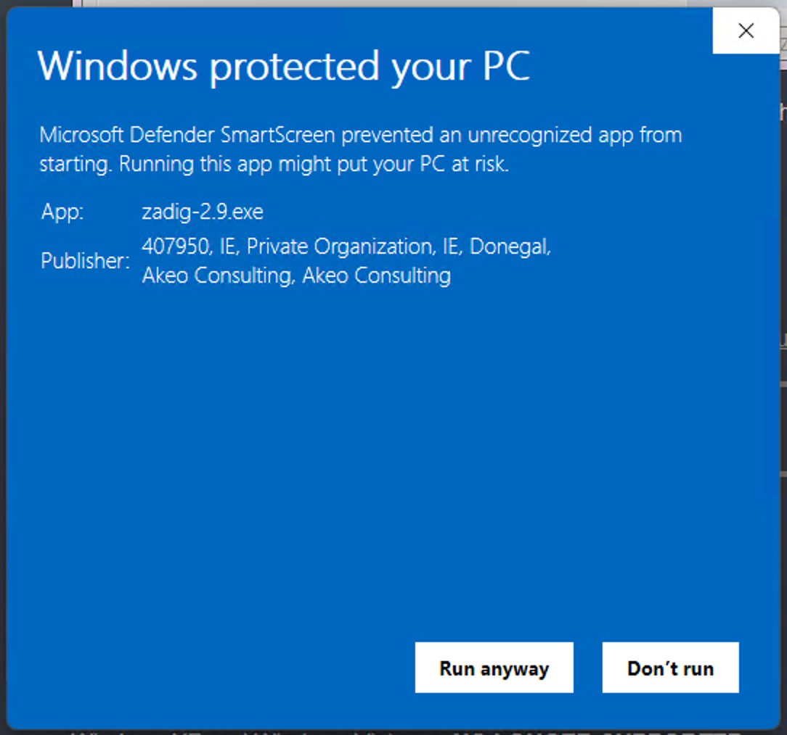
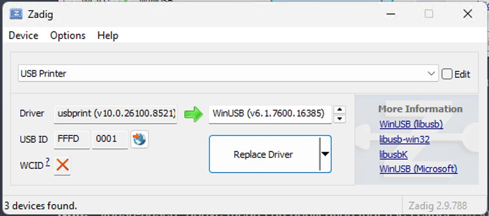
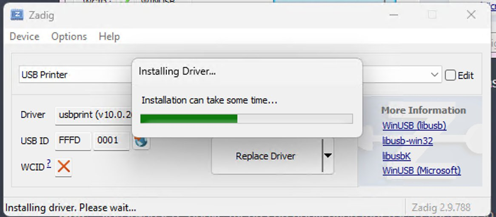
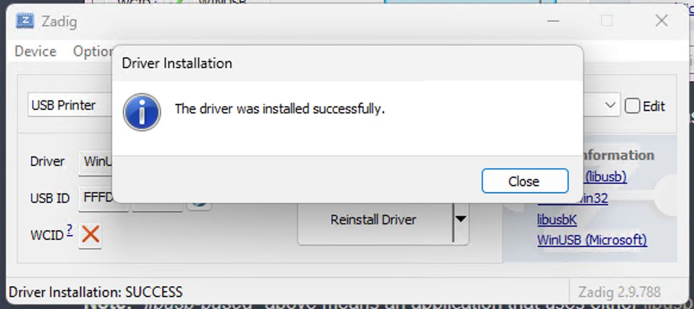
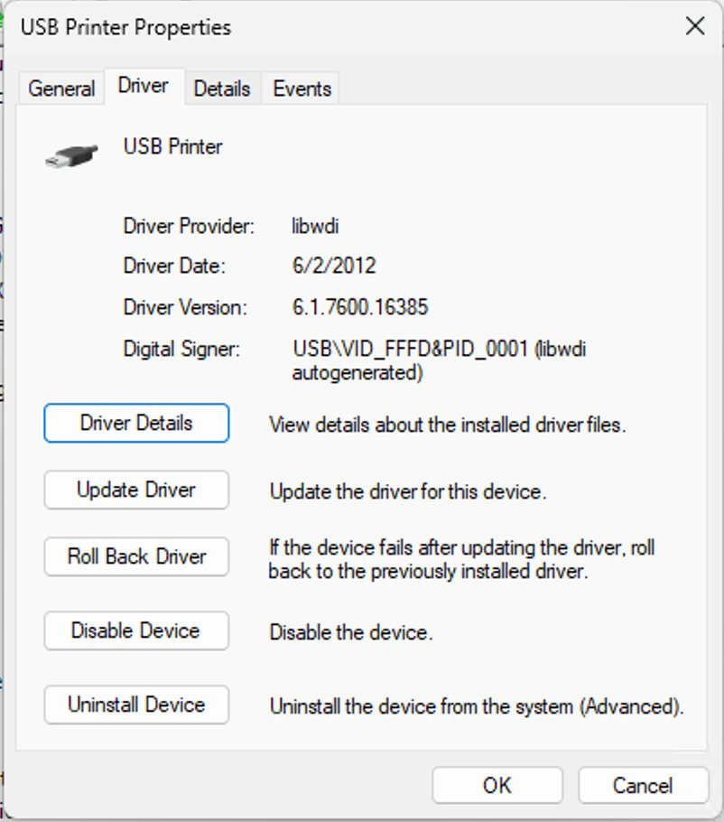
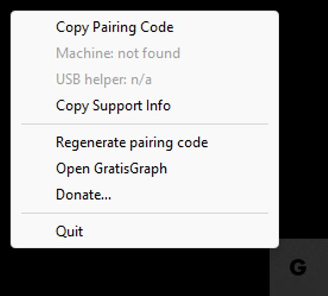
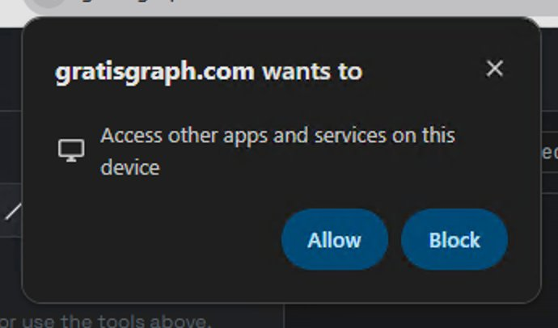
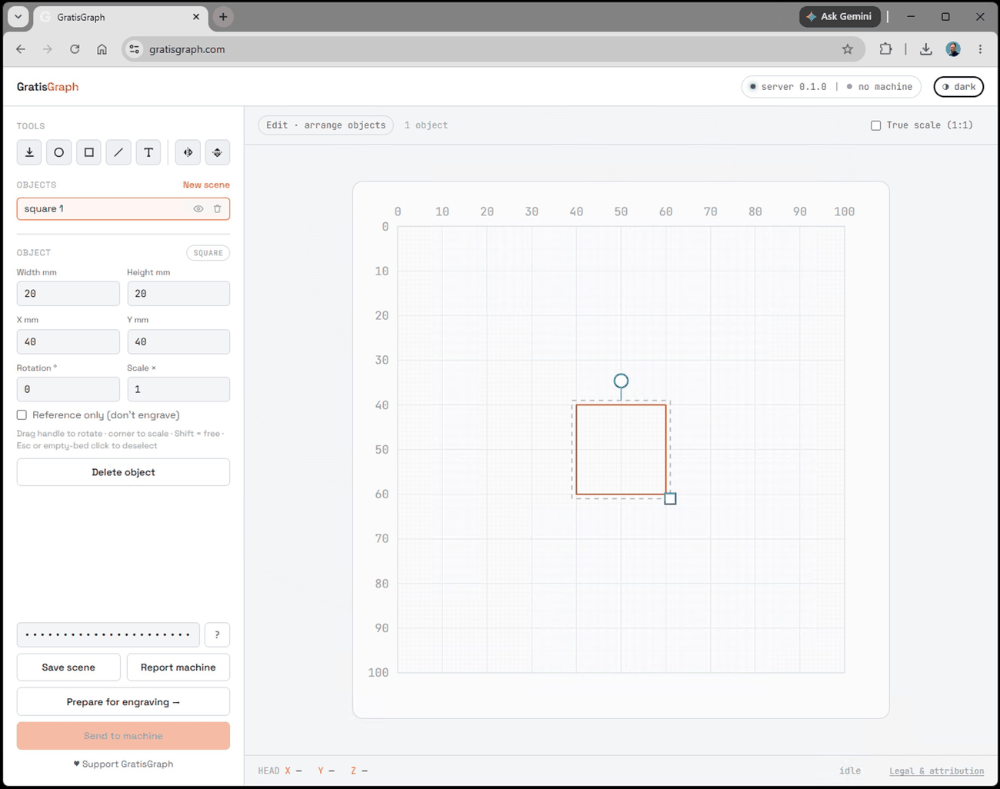
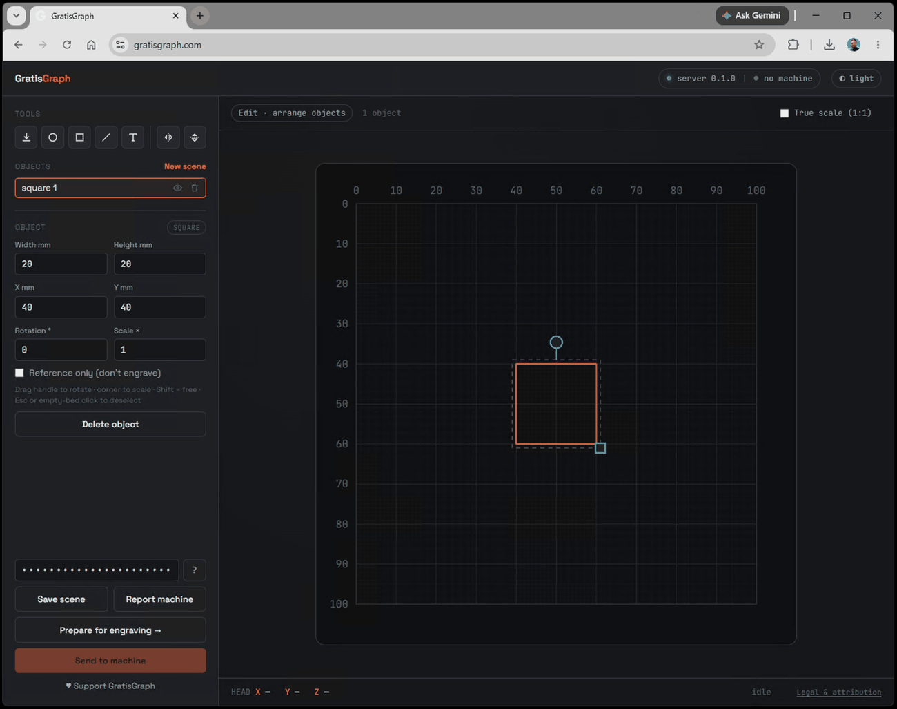

# GratisGraph — Windows Setup Guide

How to run GratisGraph on Windows and connect it to a Gravograph M20-series
engraver.

**Please treat the Windows build as early.** It is the newest of the platforms,
and it isn't code-signed yet, so Windows will show a couple of "are you sure"
prompts along the way. None of them mean anything is wrong — this guide walks you
past each one. Feedback from real Windows setups is very welcome (see the end).

This guide assumes you're connecting a Gravograph M20-series engraver — that's what
GratisGraph is for. There are four parts: get the app (Section 2), do the one-time
USB driver step so the app can talk to the machine (Section 3), pair the app with
the website (Section 4), and send a job (Section 5).

(You *can* run the app and website on their own, just to look around, by skipping
Section 3 — but the rest of this guide assumes a machine is attached.)

---

## 1. What you'll need

- A Gravograph M20-series engraver on a USB cable.
- Windows 10 or 11, 64-bit.
- A few minutes, and **admin rights** for the one-time driver step (Section 3).

---

## 2. Get the app

1. Download **`GratisGraph.exe`** from the releases page:
   <https://github.com/Stephen-Arsenault/GratisGraph/releases>
2. It's a single file — no installer. Put it anywhere (Desktop is fine). To
   "uninstall" later, just delete it.
3. Double-click it. Because it isn't signed yet, Windows SmartScreen will say
   **"Windows protected your PC."** Click **More info → Run anyway.**
4. If your antivirus grumbles, that's a false positive that unsigned single-file
   apps sometimes trigger — allow it / add an exclusion.

When it's running you'll see a small **"G" icon in the system tray** (bottom-right,
by the clock — you may have to click the **`^`** arrow to find it). That icon is
the app; closing it from its menu quits.

---

## 3. One-time USB driver step

This is a required one-time step so the app can talk to your machine over USB.
*(Skippable only if you're running app-only with no machine attached.)*

### Why this is needed

When you plug an M20 into Windows, Windows automatically treats it as a printer
and loads its own printer driver for it. GratisGraph talks to the machine over
raw USB instead, which needs Windows' generic **WinUSB** driver bound to the
device. So you tell Windows, once, to use WinUSB for this machine. A tool called
**Zadig** does this in about four clicks.

This is **reversible**, and while WinUSB is bound the machine won't show up as a
normal Windows printer (you wouldn't use it as one anyway). Reverting is in the
last step below.

> A future signed driver package is planned to make this automatic. Until then,
> it's a one-time manual step.

### Steps

1. Plug in and **power on** the M20.
2. Download **Zadig** from <https://zadig.akeo.ie> — it's a tiny standalone
   program, no installation.
3. **Right-click Zadig → Run as administrator.**
4. In the menu bar choose **Options → List All Devices.**
5. Open the big dropdown and select the device whose **USB ID is `FFFD 0001`.**
   It may be named "USB Printing Support" or "USB Printer" — the `FFFD 0001` ID
   is the reliable way to identify it.
6. Make sure the target driver (the box to the right of the green arrow) is set to
   **WinUSB.**
7. Click **Replace Driver** (or **Install Driver**) and wait for the success
   message. Done.

Here's what those steps look like:

Zadig isn't signed either, so you'll see SmartScreen for it too — **More info → Run anyway:**

The key screen — device **`FFFD 0001`** selected, target driver set to **WinUSB**, then **Replace Driver:**

It installs in a few seconds, then reports success:

You can confirm it took in **Device Manager** — the device's **Driver** tab shows
provider **libwdi** (WinUSB) bound to `USB\VID_FFFD&PID_0001`:

### To undo it later

Open **Device Manager**, find the M20 (look under "Universal Serial Bus devices"),
right-click → **Uninstall device**, tick **"Delete the driver software for this
device,"** then unplug and replug the machine. Windows will reinstall its normal
printer driver.

---

## 4. Run it and pair

1. Make sure **`GratisGraph.exe`** is running (the tray "G" is showing).
2. Open **<https://gratisgraph.com>** in your browser.
3. The website talks to the app running on your PC. To authorize it, click the
   tray **G → Copy Pairing Code**, then paste that code into the "pairing code"
   box on the website. The server dot turns green. You only do this once per
   browser.
4. With the machine powered on, the tray menu's status line should show it —
   something like **`Machine: M20 (0x0204)`.**

The tray **G** menu is where the pairing code lives (plus status, regenerate, and donate):

The first time the site reaches the local app, your browser may ask whether
**gratisgraph.com** can *"access other apps and services on this device"* — click
**Allow.** That's the browser's name for letting the page reach the local helper;
without it, the site can't see the app and will report it as offline.

If the website says the server is offline, it just means the app isn't running —
launch `GratisGraph.exe` and refresh.

### What it looks like

Once paired, this is the app. It has a light and a dark theme — toggle with the
control at the top-right:

---

## 5. Send a job

1. On the website, create or preview a design, hit **Prepare**, then
   **Send to machine.**
2. On the M20, jobs **queue** when they arrive — the machine **beeps.** Press the
   **green button** to run the queued job.
3. While it runs, the position dot on the on-screen grid should track the head.

> Safety: this moves real motors with a real cutter. Keep your hands clear and
> test a new job with a pen first.

---

## 6. Troubleshooting

- **SmartScreen blocks it** → More info → Run anyway (the app isn't signed yet).
- **Antivirus flags it** → a known false positive for unsigned single-file apps;
  allow it.
- **Website says "server offline"** → the app/tray isn't running, or your browser
  blocked the local connection. Launch `GratisGraph.exe` and refresh.
- **App can't find the machine** → re-check Zadig shows **WinUSB** on the
  **`FFFD 0001`** device, then unplug/replug the machine and relaunch the app.
- **Want the machine back as a normal printer** → revert the driver (end of
  Section 3).

---

## 7. Feedback & reporting problems

Because Windows is new, reports from real setups are genuinely useful — even
"it launched and the tray showed up." Helpful details:

- Did the `.exe` launch and the tray icon appear?
- Was the machine detected (did the status line show a model + code)?
- Did a sent job **queue (beep)** and then **run when you pressed green**?
- Did the position dot move during the run?
- Anything confusing, any error, any crash.

The easiest way to include your setup details: tray **G → Copy Support Info**, then
paste that into your report. It captures app versions, your Windows version, and
the machine status — no personal info.

**Report here:** <https://github.com/Stephen-Arsenault/GratisGraph/issues>
